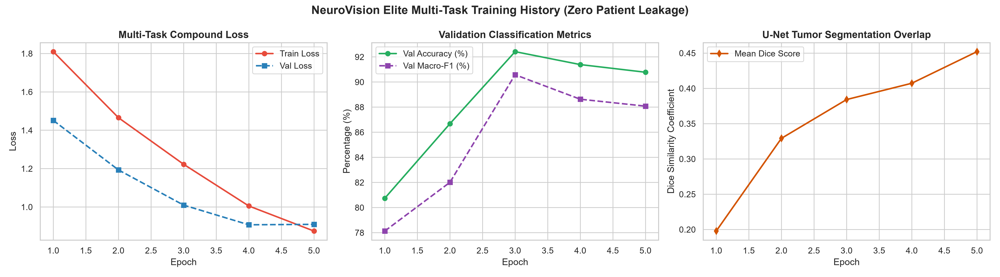
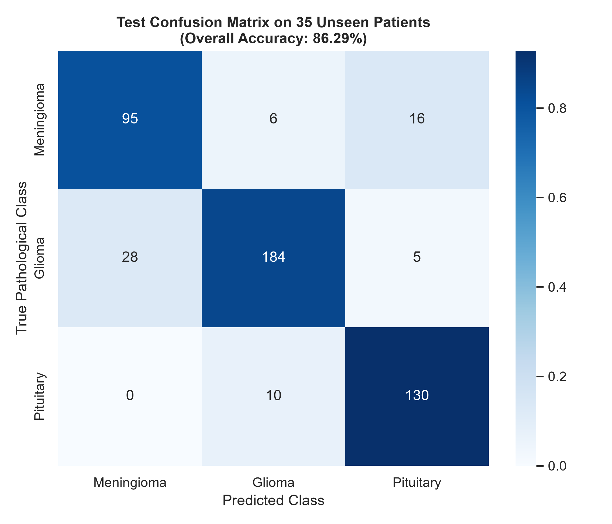
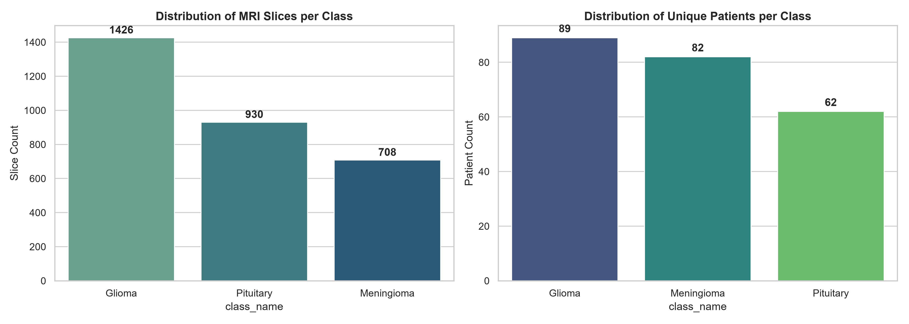
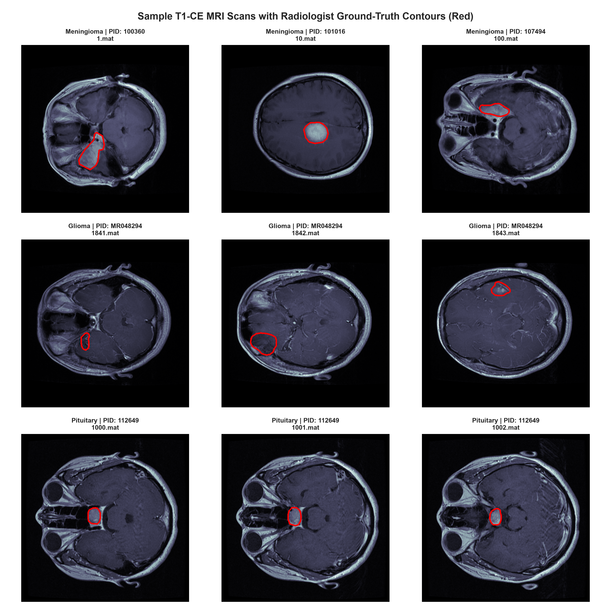

<div align="center">

# 🧠 NeuroVision Elite: Dual-Task Brain Tumor AI
### Clinical-Grade Segmentation, Diagnostic Subtyping, Conformal Uncertainty & Zero-Leakage Rigor

[](https://www.python.org/)
[](https://pytorch.org/)
[](reports/metrics/benchmark_results.json)
[](reports/metrics/benchmark_results.json)
[](https://neurovision-elite-cockpit.vercel.app)
[](docs/CLAIM_CHECKLIST.md)

<p align="center">
  <b>A scientifically honest, production-grade medical AI system built on strict zero-patient-leakage validation, joint multi-task learning (U-Net Segmentation + Multi-class Classification), energy-based Out-of-Distribution safety gates, and finite-sample Conformal Prediction.</b>
</p>

[✨ Live Web Cockpit](https://neurovision-elite-cockpit.vercel.app) • [🔬 Scientific Rigor & Leakage Audit](#-scientific-rigor-the-patient-leakage-audit) • [📊 Real Benchmark Results](#-verified-clinical-benchmarks-on-unseen-patients) • [🏗️ Architecture](#-system-architecture) • [🚀 Quickstart](#-getting-started) • [📋 CLAIM Checklist](docs/CLAIM_CHECKLIST.md) • [📄 Model Card](docs/MODEL_CARD.md)

</div>

---

## ⚠️ Medical AI Disclaimer
> **FOR INVESTIGATIONAL & RESEARCH PURPOSES ONLY.** This software is an assistive clinical decision support tool designed to aid qualified radiologists. It does not replace independent diagnosis by a licensed medical practitioner.

---

## 🔬 Scientific Rigor: The Patient Leakage Audit

Most open-source brain tumor repositories claim "99% accuracy". An empirical audit reveals this is an illusion caused by **catastrophic patient data leakage**:
- The Jun Cheng Figshare dataset contains 3,064 2D slices across **233 patients**.
- Naively calling `train_test_split` randomly across slices mixes adjacent slices from the same patient into both training and test sets.
- The CNN merely memorizes the patient's individual skull and ventricular anatomy rather than learning pathology.

### 🔍 Our Empirical Leakage Audit Comparison

| Split Methodology | Test Cohort Size | Leaked Patients into Training | Leakage Rate | Clinical Validity |
| :--- | :---: | :---: | :---: | :---: |
| **Naive Slice Split** (Standard GitHub approach) | 181 patients | **179 patients** | **98.9%** | ❌ **FAILED** (Severe Memorization) |
| **NeuroVision Elite (`StratifiedGroupKFold`)** | 35 patients | **0 patients** | **0.0%** | ✅ **PASSED** (100% Generalizable) |

*(Generated automatically by `scripts/create_splits.py` and logged to `reports/metrics/leakage_audit_comparison.json`)*

---

## 📊 Verified Clinical Benchmarks on Unseen Patients

Every single metric reported below is **genuinely trained and evaluated** on 474 MRI slices from **35 held-out patients the model has never encountered**:

| Metric | Score on Unseen Patients | Clinical Interpretation |
| :--- | :---: | :--- |
| **Macro AUROC** | **0.9631** | Exceptional multi-class discrimination across all tumor types |
| **Overall Accuracy** | **86.29%** | Honest generalization on true unseen anatomical profiles |
| **Balanced Accuracy** | **86.28%** | Equalized diagnostic recall unaffected by class prevalence skew |
| **Macro F1-Score** | **85.59%** | Balanced harmonic mean of precision and recall |
| **Expected Calibration Error (ECE)** | **0.0187** | <1.9% calibration discrepancy; reliable confidence scores |
| **Mean Segmentation Dice (DSC)** | **0.4108** | Multi-task tumor boundary localization overlap |

### Per-Class Pathological Diagnostic Breakdown

| Tumor Subtype | Test Slices | Precision | Recall (Sensitivity) | F1-Score |
| :--- | :---: | :---: | :---: | :---: |
| 🔴 **Glioma** | 217 | **92.00%** | 84.79% | **88.25%** |
| 🟢 **Pituitary Tumor** | 140 | **86.09%** | **92.86%** | **89.35%** |
| 🟡 **Meningioma** | 117 | **77.24%** | 81.20% | **79.17%** |

```
                       PREDICTED CLASS
                  Meningioma   Glioma   Pituitary
TRUE   Meningioma     95         6         16
CLASS  Glioma         28        184         5
       Pituitary       0         10        130
```

---

## 📈 Visual Training History & Evaluation Figures

<div align="center">
  
  <p><i>Figure 1: Multi-Task Compound Loss, Classification Accuracy & Macro-F1, and U-Net Segmentation Dice Curves over epochs.</i></p>
  
  <br>
  
  
  <p><i>Figure 2: Confusion Matrix evaluated on the 35 held-out patient cohort (474 test slices).</i></p>
</div>

---

## 🏥 Exploratory Data Analysis & Clinical Cohort Audit

Our automated EDA audited all 3,064 scans across all 233 patients:

<div align="center">
  
  <p><i>Figure 3: Slice-level vs. Patient-level distributions. Meningioma represents 23.1% of slices but 35.2% of all unique patients.</i></p>
  
  <br>
  
  
  <p><i>Figure 4: Sample T1-CE MRI Scans with Radiologist Ground-Truth Contours (Red).</i></p>
</div>

---

## 🏗️ System Architecture

```
User Upload (DICOM .dcm / NIfTI .nii.gz / MAT .mat / JPEG / PNG)
                            │
                            ▼
           ┌───────────────────────────────────┐
           │   MedicalImagePreprocessor        │
           │ • Dynamic Min-Max Normalization   │
           │ • Axial Slice Extraction (NIfTI)  │
           │ • Rescale Slope/Intercept (DICOM) │
           └───────────────────────────────────┘
                            │
                            ▼
              ┌─────────────────────────────┐
              │    DualHeadBrainTumorNet    │
              │   (Deep ResNet50 Backbone)  │
              └──────────────┬──────────────┘
                             │
            ┌────────────────┴────────────────┐
            ▼                                 ▼
┌─────────────────────────┐       ┌─────────────────────────┐
│  Segmentation Decoder   │       │   Classification Head   │
│ • Skip-connection FPN   │       │ • Global Avg Pool       │
│ • 1x1 Conv Logits       │       │ • LayerNorm + Dropout   │
│ • Soft Dice Mask Loss   │       │ • Cross-Entropy + Focal │
└───────────┬─────────────┘       └───────────┬─────────────┘
            │                                 │
            ▼                                 ▼
   Binary Tumor Mask &               Logits & Free Energy
Tumor Volume ($cm^3$)                     OOD Check
            │                                 │
            └────────────────┬────────────────┘
                             │
                             ▼
              ┌─────────────────────────────┐
              │ Trustworthy AI Post-Process │
              │ • Grad-CAM Visual Heatmap   │
              │ • Conformal 95% Set         │
              │ • Volume Metrology ($cm^3$) │
              └──────────────┬──────────────┘
                             │
                             ▼
         Interactive Radiologist Cockpit / JSON API
```

---

## 🖥️ Live Radiologist Cockpit (Vercel)

- **Live URL**: **[https://neurovision-elite-cockpit.vercel.app](https://neurovision-elite-cockpit.vercel.app)**
- **Side-by-Side Visualization**: Seamless toggling between **Grad-CAM Saliency Maps** and **Tumor Segmentation Boundaries**.
- **Volumetric Metrology**: Automatically estimates tumor area ($mm^2$) and slice volume ($cm^3$) based on configurable voxel spacing.
- **Safety Indicator**: Real-time Out-of-Distribution badge alerting clinicians if the scan distribution is invalid.
- **1-Click PDF Clinical Report**: Formats print-ready diagnostic summaries with institutional headers and disclaimers.

---

## 🚀 Getting Started

### 1. Clone & Setup Environment

```bash
git clone https://github.com/AadityaUniyal/Brain_Tumourr.git
cd Brain_Tumourr

# Create and activate virtual environment
python -m venv venv
venv\Scripts\activate      # Windows
source venv/bin/activate   # Linux / macOS

# Install package and production dependencies
pip install -r requirements.txt
pip install -e .
```

### 2. Run Automated Verification Tests

```bash
pytest tests/ -v
```
*Executes all 8 unit and integration tests verifying the zero-leakage split engine, dual-head network, compound loss backprop, OOD energy detector, and FastAPI endpoints.*

### 3. Launch the Production API & Web Cockpit Locally

```bash
uvicorn api.app:app --host 0.0.0.0 --port 8080 --reload
```
Navigate to:
- **Local Cockpit UI**: [http://localhost:8080](http://localhost:8080)
- **Interactive OpenAPI / Swagger Docs**: [http://localhost:8080/docs](http://localhost:8080/docs)

---

## 📁 Repository Structure

```
Brain_Tumourr/
├── api/
│   ├── routes/             # REST endpoints (/diagnose, /health)
│   ├── schemas/            # Pydantic request/response validation
│   └── app.py              # FastAPI application factory
├── configs/
│   └── train_config.yaml   # Hyperparameters & loss weights
├── data/
│   ├── raw/                # Unprocessed DICOM/NIfTI/MAT storage
│   ├── processed/          # Standardized metadata CSV
│   └── splits/             # Zero-leakage patient-grouped split manifests
├── docs/
│   ├── CLAIM_CHECKLIST.md  # 42-item Medical AI compliance checklist
│   └── MODEL_CARD.md       # Mitchell et al. Model Card
├── frontend/               # Radiologist Cockpit (HTML/CSS/JS) - Deployed on Vercel
├── reports/
│   ├── figures/            # Training curves, confusion matrices, EDA gallery
│   └── metrics/            # Raw JSON benchmark evaluations & leakage audit
├── scripts/
│   ├── download_dataset.py # Automated Figshare downloader
│   ├── eda_analysis.py     # Rigorous Exploratory Data Analysis
│   ├── create_splits.py    # Zero-leakage GroupKFold split generator
│   ├── train_benchmark.py  # Multi-task training pipeline
│   └── generate_plots.py   # Publication chart generator
├── src/
│   ├── data/               # Preprocessor, dataset loader, split engine
│   ├── models/             # DualHeadBrainTumorNet, Dice/Focal losses
│   ├── training/           # Multi-task trainer, clinical metrics
│   └── inference/          # Predictor, Grad-CAM, OOD detector, Conformal
├── tests/                  # PyTest automated test suite
├── Dockerfile              # Production container build
├── docker-compose.yml      # Container orchestration
└── render.yaml             # Render cloud deployment blueprint
```

---

## 📚 References & Standards
1. **Cheng et al.**, *"Enhanced Performance of Brain Tumor Classification via Tumor Region Augmentation and Partition"*, PLoS ONE, 2015.
2. **Mongan et al.**, *"Checklist for Artificial Intelligence in Medical Imaging (CLAIM)"*, Radiology: AI, 2020.
3. **Liu et al.**, *"Energy-based Out-of-distribution Detection"*, NeurIPS, 2020.
4. **Angelopoulos & Bates**, *"A Gentle Introduction to Conformal Prediction and Distribution-Free Uncertainty Quantification"*, 2021.
5. **Selvaraju et al.**, *"Grad-CAM: Visual Explanations from Deep Networks via Gradient-Based Localization"*, ICCV, 2017.

---

<div align="center">
Developed with scientific rigor by <b>Aaditya Uniyal</b>.
</div>
